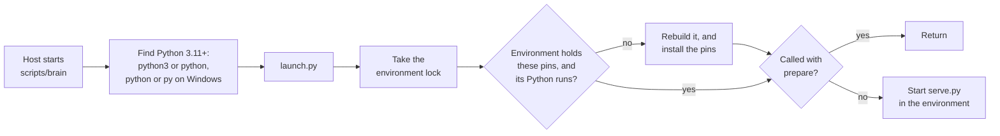

# The MCP server

The MCP server in [`plugin/server/`](../plugin/server/) is how an agent reaches the Brain. It is the translation between [the core module](core-module.md) and the model's context, and holds no logic about the data of its own: every tool calls the core module, so every tool runs code the core module's tests already cover. No tool is for a particular type of entry, so the server is never extended for a new one; what a type means is [the skill's](skills.md) that writes it. It carries the core module's rules in each tool's description, so an agent without the skills still writes valid entries.

| Module | Holds |
| --- | --- |
| [`serve.py`](../plugin/server/serve.py) | The server and its tools, built on the official MCP SDK. |
| [`folders.py`](../plugin/server/folders.py) | Finding the plugin data folder, and keeping the install's Brain folder in its settings. Standard library only, so the launcher can use it. |
| [`launch.py`](../plugin/server/launch.py) | Preparing the machine and starting the server. Standard library only. |

The plugin carries a manifest and a server config in two formats, and each host reads its own: [`plugin.json`](../plugin/plugin.json) and [`mcp.json`](../plugin/mcp.json) in the Agent Plugins format, for Codex, Cursor, and any other host of it, and [`.claude-plugin/plugin.json`](../plugin/.claude-plugin/plugin.json) and [`.mcp.json`](../plugin/.mcp.json) for Claude Code. Neither asks for anything at install, and neither runs a hook. [`test_manifests.py`](../tests/test_manifests.py) keeps them in step: both name the plugin `brain`, start the same launcher, and set nothing an install chooses.

## Starting

The server runs over stdio: the agent's host starts it for a session and stops it with the session. It runs on the machine's own Python, 3.11 or later, in a virtual environment that holds the SDK.

- **The launch scripts.** No one command starts Python everywhere: Windows has `python` and `py`, where `python3` is often a stub that offers to install it, and macOS and many Linux systems have only `python3`. So the host runs [`scripts/brain`](../plugin/scripts/brain), a POSIX shell script, or on Windows [`brain.cmd`](../plugin/scripts/brain.cmd) beside it, and each tries its candidates in turn, taking the first that is 3.11 or later. The scripts are in `scripts/`, not `bin/`: claude.ai and Cowork do not install a plugin with a top-level `bin/` folder.
- **Preparing.** [`requirements.txt`](../plugin/requirements.txt) pins every package the server needs to an exact version, for every platform, so every machine runs the same set the tests passed with, and a new release of a package several steps down the chain cannot break one install and not another. The pins do not go stale: Dependabot opens a pull request each week bumping them, and one for a security fix as soon as it is published, and CI tests each on every platform before it merges. The pins are compiled from [`requirements.in`](../plugin/requirements.in), which names only the packages the server uses, and Dependabot recompiles the whole set for each bump, so packages released in lockstep, such as `pydantic` and `pydantic-core`, move together, where bumping each pin on its own can propose a `pydantic-core` no stable `pydantic` accepts. The pins carry no hashes: hashes guard only against a file added to an already-pinned version, would make the file hundreds of lines long, and Dependabot cannot regenerate them for every platform. The environment is built in the plugin data folder, which survives plugin updates, and is rebuilt whole when the pins change or its Python no longer runs, so nothing an older pin installed lingers. The copy of the pins in the environment is written last, so one a crash left half built is built again.
- **Prepared as the server starts.** The launcher prepares the environment before it starts the server, so nothing has to run first and no host has to run a hook. A lock in the plugin data folder makes sessions starting together take turns, and the second finds the work done. The first start, which builds the environment, is the slow one; one that outlasts the host's wait for a server costs that session its tools, the build finishes, and the next session starts in about a second.
- **The SDK.** The server is built on the official MCP Python SDK rather than a protocol written here, so the protocol is kept correct by its maintainers. The cost is about 30 packages, a download of about 20 seconds on a machine's first session, and an occasional pin bump when a new Python needs newer builds of the SDK's compiled packages.

## Folders

| Folder | Set by | Holds |
| --- | --- | --- |
| The Brain folder | the user, once per install | the records in `events/` and the filed documents in `documents/` |
| The plugin data folder | the host, or else a fixed folder for the user | the install's `settings.json`, the virtual environment and its lock, and the lock, current file, and index the core module keeps |

- **The Brain folder** is the first of these that is set: `BRAIN_DIR`, which tests and a server started by hand set; then `brain_folder` in the data folder's `settings.json`, which the `configure` tool writes. With neither, an install from when Claude Code asked for the folder at install carries it over from Claude Code's own `settings.json`, in `CLAUDE_CONFIG_DIR` or else `~/.claude`: of the `brain_folder` values its `pluginConfigs` keep for the plugin `brain`, under any marketplace, the one this install's data folder already holds files for is written to the data folder's `settings.json`. A fresh install holds none, so it never takes another install's folder. That file is only read, never written, since Claude Code rewrites it itself. None found, or several, and the Brain is not configured. A second machine pointed at the same synced folder reaches the same Brain as another writer.
- **The server starts whatever is wrong with the Brain folder**, so the user hears it in the conversation instead of finding the tools missing. While no folder is configured, the folder is missing, or the settings cannot be read, `write`, `search`, and `read` answer with what is wrong and how to put it right, and `configure` and `status` still work. Once `configure` sets the folder, the same session carries on in it.
- **A Brain folder that does not exist is never created unasked**: a sync folder that is not mounted must not quietly become a new, empty Brain. The tools say so, naming it, and tell the model to ask the user whether to create it; `configure` creates it only when called with `create`.
- **A path is read as the machine's own.** `~` is expanded, and on Windows a drive written as Git Bash writes it, `/d/`, is read as `D:`, since a model working in Git Bash hands paths over in that form and nothing converts them in a tool call.
- **The plugin data folder** is `PLUGIN_DATA`, which the Agent Plugins format has every host give its servers, and otherwise a fixed folder for the user, `%LOCALAPPDATA%\AI.Brain` on Windows, `~/Library/Application Support/AI.Brain` on macOS, and `$XDG_DATA_HOME/ai-brain`, by default `~/.local/share/ai-brain`, elsewhere. The code names no host, so a host it has never heard of works the same. Claude Code names its folder `CLAUDE_PLUGIN_DATA` instead, so its server config sets `PLUGIN_DATA` from it: a host's own name for its data folder appears only in its own manifest. A value still holding `${` was not expanded, and counts as unset. The launcher logs which folder it chose and why.
- **The plugin data folder is never inside the Brain folder or the plugin's install folder**, which is replaced on every update. The launcher refuses either before it prepares anything, checking against the Brain folder `BRAIN_DIR` or `settings.json` names; the server reports a data folder inside the Brain folder as what keeps the Brain from being used, and `configure` refuses a folder that holds the data folder. Any other choice is safe: sessions that do not share a plugin data folder write separate files and never touch each other's, so a host that gives each session a fresh folder costs only small files and a fresh environment.

## Tools

| Tool | Does |
| --- | --- |
| `write` | creates an entry of any type under a slug, or revises one given its id, and returns the record's id |
| `search` | finds entries of every type by words, slugs, or names, type, event date, recorded time, and `details` fields, returning each hit's id, type, slugs, event date, recorded time, description, snippet, and the names that found it: every hit, or a failure telling how to refine a search that finds more than 100 |
| `read` | returns the entries for a list of ids in one call, as Markdown |
| `list_documents` | lists one folder of the filed documents: its subfolders, each with how many documents it holds, and its documents |
| `store_document` | files a document at a path inside the filed documents, moving the original when asked, and returns its path and sha256 |
| `check_documents` | reports how the documents at a path differ from their entries: changed, moved, missing, and unrecorded |
| `configure` | sets the install's Brain folder, or changes it, creating it only when told to, and returns it |
| `status` | reports the Brain folder and where it was set, what keeps the Brain from being used, the data folder and why it was chosen, the Python, and the installed version of each package `requirements.in` names |

`write`, `search`, and `read` each call the core module's operation of the same name, `Writer.write`, `Reader.search`, and `Reader.read`, directly, and the three document tools call its `Documents`: `browse`, `store`, and `check`. `configure` and `status` concern the install, not the data. Each tool returns one JSON object, compact, as its text, except `read`. Reads are marked read-only, so a host can allow them without asking.

- **Work on the Brain's files is the server's.** Filing touches the Brain folder and the index, which only the server knows, and runs no shell, so it works on a host that fills in nothing in a skill's text or gives the model no shell.
- **`store_document` is marked destructive**, since it can remove the original, so a host that asks before a destructive tool asks. A document being filed can carry text telling the model to file others, and a tool may be allowed once and never checked again, so the original is removed only once its copy is in place: at worst a file ends up in the Brain, never lost.
- **A file to file is given by its absolute path.** The server's working folder is not the model's, so a relative path is refused, with how to give it whole.

- **`read` returns Markdown.** The core module keeps every record as JSON; the server translates for the model at this boundary. Each entry is a heading of its description, a line of its fields, its slugs, aliases, and links, the entry it is merged into if any, and its details, then its body on real lines and its amendments under it, with entries separated by a line of `---`. A host passes a large result to the model as a file instead of inline, and JSON puts a whole body on one escaped line that a model cannot page through; in testing, a model reading four long entries as JSON spent over a minute slicing that line apart, where as Markdown it read them inline, or with one ordinary read of the file.
- **`read` has no ceiling of its own.** It returns every record asked for, and the host decides whether a result goes to the model inline or as a file. The host knows its model and tools, and its thresholds can change from one release to the next, so the server does not try to match them. The MCP protocol sets no limit. Claude Code puts at most 25,000 tokens of a tool result in front of the model by default (`MAX_MCP_OUTPUT_TOKENS`), and saves a larger result whole to a file the model reads a part at a time: tested with reads of 100,000, 200,000, and 300,000 tokens of real entries, every file matched what the server sent, to the character. What limits a large read is how much the model can hold at once, so reading long entries a handful at a time is the query skill's guidance, not a refusal in the tool.

A failure the model can put right comes back as an error result carrying the core module's message, which says how: a slug already taken, with the entry that carries it, a link no entry carries, a bad date or pattern, a search past the ceiling with the ranges to search instead, or a lock or file another process held too long. Any other failure is a crash, logged with its traceback, and the model sees only that the tool failed.
